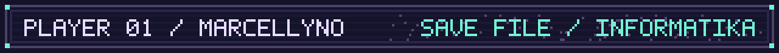
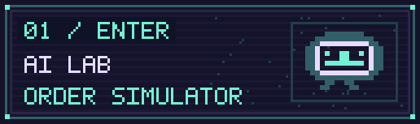
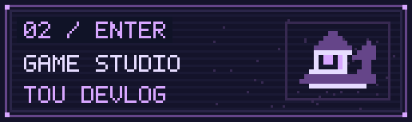
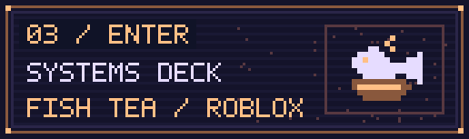
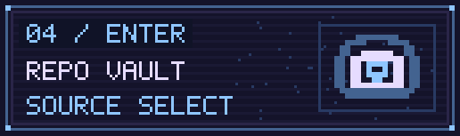
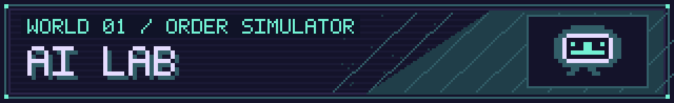
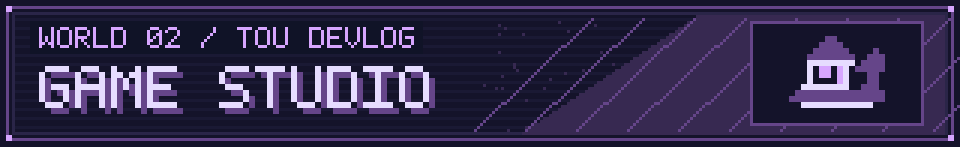
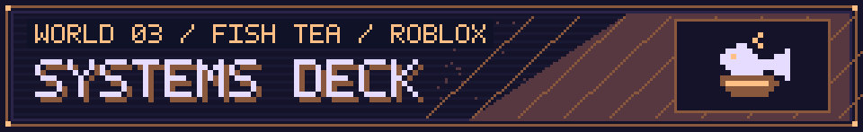
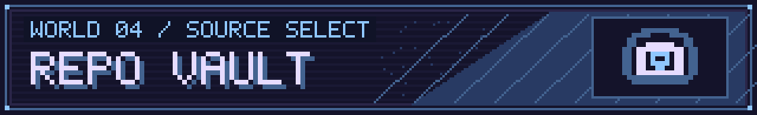
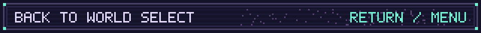

> Di Unity, saya bisa bikin kota yang enak dilihat tapi masih terasa kosong. Di WhatsApp, saya bisa bikin agent yang jawabannya meyakinkan tapi belum tentu mencatat pesanan yang benar. Saya suka bagian setelah prototipe pertama jadi: mencari tahu **apa yang masih gagal**, lalu memperbaikinya.

## 

  
  

  
  

## 

### Kalau pelanggan bilang “eh, ganti jadi tiga”?

Saya membangun prototipe agent pemesanan WhatsApp dengan **Google ADK** untuk skripsi. Contoh berikut menunjukkan keputusan desain yang penting: kalau detail pesanan berubah, persetujuan atas ringkasan lama tidak ikut berlaku.

<b>A ▸ Pelanggan setuju dengan ringkasan</b>

Agent bisa melanjutkan alur dengan rincian yang disetujui. Dalam penelitian saya, yang dicek adalah **tindakan yang dipilih agent dan hasil pencatatannya**, bukan sekadar apakah balasannya terdengar natural.

<b>B ▸ Pelanggan mengubah jumlah</b>

Ringkasan lama tidak lagi cocok. Agent perlu memperbaruinya dan meminta persetujuan atas rincian yang baru. Kalau isi chat terlihat benar tapi yang tercatat masih jumlah lama, skenario itu tetap gagal.

## 

### TOU / Kota yang masih terasa kosong

**Save point:** Di prototipe Unity, saya sudah mengiterasi pencahayaan, material, dan lingkungan. Tampilan kotanya mulai saya suka, tapi lensa berikutnya adalah pengalaman berjalan di dalamnya: apa yang menarik perhatian, ke mana pemain ingin belok, dan pintu mana yang pantas bisa dibuka?

<b>▸ Jalan keliling kota</b> · Buka catatan level design

Saya membedah kota di *Blue Protocol*, *Monster Hunter*, dan *Final Fantasy*: bagaimana jalan mengarahkan pemain, di mana NPC masuk akal untuk ditemui, dan bagaimana props memberi petunjuk tentang fungsi suatu tempat. Itu referensi untuk iterasi berikutnya, bukan fitur yang sudah selesai di TOU.

<b>▸ Masuk bengkel karakter</b> · Buka catatan sculpting

NPC sudah mulai dibuat, tapi hasil awalnya belum sesuai arah visual. Fokus saya sekarang adalah membenahi **siluet dan proporsi** dulu. Kalau bentuknya belum terbaca dari kamera third-person, menambah detail permukaan tidak akan menyelesaikan masalahnya.

<b>▸ Ganti cartridge: LaMonth</b> · Eksperimen naratif

Di LaMonth, saya ingin pemain mengikuti cerita tanpa selalu diberi daftar quest. Tantangannya: bagaimana dialog dan kondisi tempat bisa membuat orang penasaran ke mana harus pergi, tanpa bikin mereka nyasar karena tidak ada petunjuk?

## 

### Fish Tea

Salah satu proyek game saya di **Roblox**.

<b>▸ Buka terminal BMKG Earthquake Monitor</b> · Jenkins

Saya membuat job Jenkins terjadwal yang membaca data gempa BMKG, mencatat hasilnya, lalu mengirim notifikasi lewat **Telegram** dan **WhatsApp**. Satu kali jalan sukses di terminal belum cukup buat demo ini: saya juga perlu melihat job berjalan dari timer Jenkins.

## 

`A1` [Environment-GameDev](https://github.com/xenonnnn222/Environment-GameDev)  
`A2` [gamedev-mid-sam](https://github.com/xenonnnn222/gamedev-mid-sam)  
`B1` [PasarKu](https://github.com/xenonnnn222/PasarKu)

